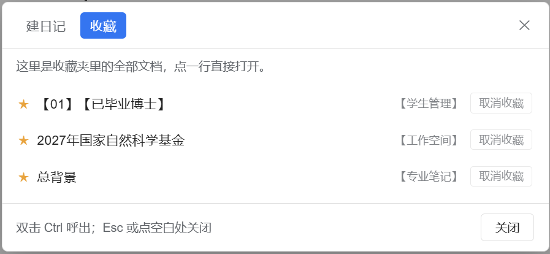

# Doc Favorites · 文档收藏夹

Star documents from the document tree; press **Ctrl twice** inside SiYuan to open a two-tab window — **Create today's note** and **Favorites**.

在文档树右键给文档打星标；在思源里**快速按两下 Ctrl**，弹出两个 tab 的小窗口 —— **建日记** 和 **收藏**。

---

## English

### What it solves

With hundreds of notes, frequently used documents are hard to find in the tree, and creating today's daily note takes several clicks. This plugin pins the important documents and turns "create today's note" into one click.

### Three actions

1. **Star / unstar** — right-click any document in the document tree (multi-select works). The menu shows `☆ Add to favorites` or `★ Remove from favorites`.
2. **Ctrl twice → Create today's note** — click any notebook row; the plugin creates today's note at **that notebook's own daily-note path** and opens it immediately. If today's note already exists, it just opens it (no duplicate).
3. **Ctrl twice → Favorites** — lists every starred document; click a row to open it, or click `Remove` at the end of the row to unstar it on the spot (the document itself is untouched).

### The window

| Where | What it does |
|---|---|
| Tabs at the top | `Create today's note` / `Favorites`; opens on the first tab |
| Create tab | Lists the notebooks you chose, with the path that will be generated today |
| `Edit` (bottom right of Create tab) | Choose which notebooks appear; every open notebook can be ticked |
| Favorites tab | Star + title + notebook name; click to open, `Remove` to unstar |
| Close | `Esc`, the ✕ button, or click outside the card |

**Create today's note tab**


**Favorites tab**



Ctrl-twice works **inside the SiYuan window only** — the plugin runs in the front-end and does not install a global keyboard hook.

### On another computer (important)

Notebook IDs are machine-specific. If the notebooks saved on your machine do not exist on someone else's, the Create tab does **not** go blank:

- **Never configured** (fresh install) → it lists **all open notebooks** on that machine;
- **Configured but none of them exist here** (e.g. synced settings from another PC) → it shows a hint asking you to click `Edit` and pick again.

So a new user always has something clickable, and can narrow the list later with `Edit`.

### How favorites are stored

Favorites are two hidden attributes on the **document block**:

- `custom-fav` — timestamp (`YYYYMMDDHHmmss`); present means starred
- `custom-fav-order` — sort order

The plugin **never moves, renames or edits** a document. SiYuan identifies documents by ID, so favorites survive renaming and moving between notebooks, and disappear automatically when the document is deleted. Attributes travel with SiYuan sync, so the same account sees the same favorites on every computer with this plugin installed.

### Install

1. Copy the whole folder to `<workspace>/data/plugins/siyuan-plugin-doc-favorites/`.
2. In SiYuan: `Settings → Plugins` → refresh → enable **Doc Favorites**.
3. Or just press `Ctrl+R` to reload the UI.

### Repository layout

This repository **is** the plugin package: the repo root is exactly what you copy into `<workspace>/data/plugins/siyuan-plugin-doc-favorites/`. `index.js` is the built entry SiYuan loads; `plugin.json`, `icon.png`, `i18n/` and `README.md` sit next to it.

```bash
git clone https://github.com/taotaochen86/siyuan-plugin-doc-favorites.git
# copy the folder into <workspace>/data/plugins/
```

### Changelog

- **v0.2.6** — Create tab no longer depends on two hard-coded notebooks: unconfigured machines list all open notebooks; missing configured notebooks show a hint instead of a blank list. Bilingual README.
- v0.2.5 — Remove left-dock panel; keep only the Ctrl-twice window. Favorites tab can unstar rows in place (local-first update, re-checked after 1.2 s in case the SQL index lags).
- v0.2.4 — Add "Remove from favorites" button inside the Favorites tab.
- v0.2.3 — Drop the left favorites panel and its dock icon.
- v0.2.2 — Add a second tab: all favorites, click to open.
- v0.2.1 — One-click create: clicking a notebook row creates today's note and jumps to it; `Edit` button to choose notebooks.
- v0.2.0 — Ctrl-twice dialog; creates daily notes at each notebook's own path.
- v0.1.0 — First release: context-menu starring, left dock panel, search, reorder, unstar.

---

## 中文

### 它解决什么

笔记多了以后（几百上千篇），常用文档在文档树里很难翻；每天写日记也要点好几次。这个插件把常用文档钉住，把「建今天的日记」变成一次点击。

### 三个动作

1. **收藏 / 取消收藏** —— 文档树里右键任意文档（可多选），菜单出现 `☆ 收藏到收藏夹` 或 `★ 取消收藏`。
2. **双击 Ctrl → 建日记** —— 点任意一行笔记本，插件按**该笔记本自己的「新建日记」路径**创建今天的文档，并立即打开；今天已存在就直接打开，不重复建。
3. **双击 Ctrl → 收藏** —— 列出全部已收藏文档；点一行打开，行尾点「取消收藏」当场移除（只清收藏属性，文档本身不动）。

### 窗口说明

| 位置 | 作用 |
|---|---|
| 顶部 tab | 「建日记」/「收藏」，默认停在建日记 |
| 建日记页 | 列出你选定的笔记本，右侧显示今天将生成的路径 |
| 建日记页右下「编辑」 | 选择显示哪些笔记本，所有已打开的库都能勾 |
| 收藏页 | 星标 + 标题 + 笔记本名；点行打开，点「取消收藏」移除 |
| 关闭 | `Esc`、右上 ✕、点卡片外空白 |

**建日记页**


**收藏页**


双击 Ctrl 只在**思源窗口内**生效 —— 插件跑在前端，没有做全局键盘钩子。

### 换到别人的电脑（重要）

笔记本 ID 是跟机器/库走的。如果本机没有你保存的那两个笔记本，建日记页**不会空白**：

- **从没配置过**（刚装插件）→ 直接列出这台电脑上**所有已打开的笔记本**；
- **配置过、但这些笔记本在本机不存在**（比如从别的电脑同步了设置）→ 显示提示，让你点「编辑」重新选。

这样新用户第一次打开一定有东西可点，之后再按「编辑」收窄到自己常用的几个。

### 收藏数据怎么存

收藏只在**文档块**上写两个隐藏属性：

- `custom-fav` —— 收藏时间戳（`YYYYMMDDHHmmss`），存在即已收藏
- `custom-fav-order` —— 排序号

插件**从不移动、改名、修改**文档。思源靠文档 ID 认文档，所以改名、移动笔记本都不掉收藏，删除文档会自动从清单消失。属性随思源账号同步，同一账号在装了本插件的每台电脑上看到同一份收藏。

### 安装

1. 把整个文件夹复制到 `<工作空间>/data/plugins/siyuan-plugin-doc-favorites/`。
2. 思源「设置 → 插件」→ 刷新 → 启用「文档收藏夹」。
3. 或直接按 `Ctrl+R` 重载界面。

### 仓库结构

本仓库**就是**插件包本身——仓库根目录直接对应 `<工作空间>/data/plugins/siyuan-plugin-doc-favorites/`。`index.js` 是思源加载的构建入口，`plugin.json`、`icon.png`、`i18n/`、`README.md` 与它并列。

```bash
git clone https://github.com/taotaochen86/siyuan-plugin-doc-favorites.git
# 复制文件夹到 <工作空间>/data/plugins/
```

### 版本记录

- **v0.2.6** —— 建日记页不再依赖写死的两个笔记本：没配置过就列全部已打开的笔记本；配置的库在本机不存在时给提示而不是空白。README 改为中英双语。
- v0.2.5 —— 去掉左侧收藏面板，只保留双击 Ctrl 窗口；收藏页行尾可当场取消收藏（先本地减一条，1.2 秒后再校正 SQL 索引）。
- v0.2.4 —— 收藏页内新增「取消收藏」按钮。
- v0.2.3 —— 移除左侧收藏面板及停靠栏图标。
- v0.2.2 —— 增加第二个 tab：全部收藏，点击打开。
- v0.2.1 —— 点击即建：点笔记本行直接建今天的日记并跳转；新增「编辑」按钮选择笔记本。
- v0.2.0 —— 双击 Ctrl 弹窗，按各库自己的日记路径建日记。
- v0.1.0 —— 首版：右键收藏、左侧栏面板、搜索、排序、取消收藏。
