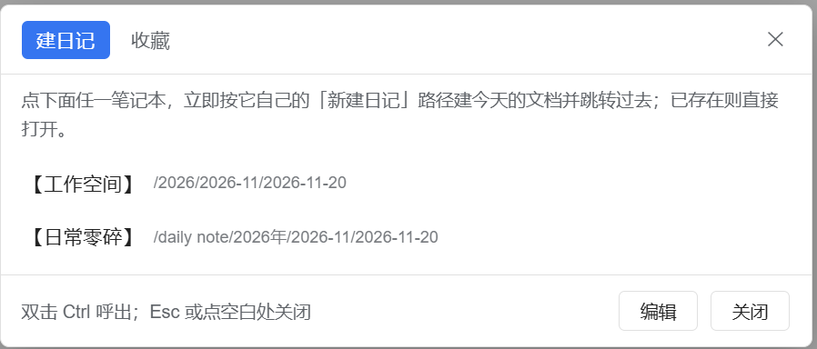

# 文档收藏夹（siyuan-plugin-doc-favorites）v0.2.8

**简体中文** | [English](#english)


## 1 一句话概括

常用文档右键打个星，之后在思源里连按两下 Ctrl 就能调出来；同一个窗口里点一下笔记本，今天的日记就建好并跳过去。

## 2 主要功能

| 功能 | 说明 |
|---|---|
| 2.1 右键收藏 | 左侧文档树里右键任意文档，菜单出现「☆ 收藏到收藏夹」；已收藏的显示「★ 取消收藏」。支持多选，一次给一批文档打星 |
| 2.2 双击 Ctrl 呼出 | 思源窗口内快速连按两下 Ctrl（两次间隔不超过 350 毫秒），弹出小窗口。Esc、右上 ✕、点卡片外空白都能关 |
| 2.3 建日记 | 第一个 tab 列出你选定的笔记本，右侧写着今天会生成到哪。点任意一行，立刻按这个库自己的「新建日记」路径建今天的文档，建完直接打开；今天就有的，直接打开，不重复建 |
| 2.4 收藏 tab | 全部收藏文档，一行一条：星标、标题、所属笔记本。点一行打开 |
| 2.5 就地取消收藏 | 收藏行尾的「取消收藏」点一下，这一条当场从列表消失，文档本身一个字不动 |
| 2.6 编辑显示范围 | 建日记页右下角「编辑」，勾选哪些笔记本出现在列表里。所有已打开的库都能勾 |
| 2.7 换电脑不空白 | 新电脑第一次打开，列表直接列全部已打开的笔记本；从别处同步来的配置在本机找不到对应库时，给一句提示，让你点「编辑」重选 |

**建日记页**



**收藏页**


## 3 它解决了什么问题

| 平时的麻烦 | 装上之后 |
|---|---|
| 3.1 常用文档埋在几百篇笔记里，每次都要从头翻文档树 | 右键打星，双击 Ctrl 集中调出，点一下就到 |
| 3.2 每天写日记要点好几下：找菜单、选笔记本、确认日期 | 点一下笔记本就建好并跳过去，一次点击 |
| 3.3 不同笔记本的日记放在不同位置，靠脑子记 | 插件读每个库自己配的「新建日记」路径，按它的规则生成，不用记 |
| 3.4 换台电脑，常用文档要重新找一遍 | 收藏存在文档属性里，跟着思源同步走，同一账号每台机都是同一份 |
| 3.5 别的收藏工具要么建索引库，要么搬动文档 | 不建库、不搬文档，只写一个属性；文档改名、换笔记本都不掉收藏 |

## 4 安装

**从 Release 装**

1. 下载最新 Release 里的 `package.zip`
2. 解压到 `<工作空间>/data/plugins/siyuan-plugin-doc-favorites/`。zip 根层就是插件文件，不要再套一层同名目录
3. 重启思源，或按 `Ctrl+R` 重载界面

**手动装**

把本仓库整个文件夹复制到上面那个目录，效果一样。

**从集市装**

审核通过后，在 设置 → 集市 → 插件 里搜「文档收藏夹」直接安装。

装完到 设置 → 插件 里确认「文档收藏夹」处于启用状态。

## 5 配置

### 5.1 依赖

| 项目 | 要求 |
|---|---|
| 思源笔记 | 3.1.0 以上 |
| 平台 | 桌面端（Windows / macOS / Linux），网页版与手机端用不了 |
| 外部服务 | 不需要。没有令牌、没有账号、不联网、不读写本机其他软件 |

### 5.2 唯一要配的一项

建日记页显示哪些笔记本：

1. 双击 Ctrl 呼出窗口
2. 点右下角「编辑」
3. 勾选要出现在列表里的笔记本
4. 保存，列表按新选择刷新

第一次装好不配也能用，默认列出这台电脑上全部已打开的笔记本。之后按「编辑」收窄到自己常用的几个。

### 5.3 配置存在哪

这份选择存在本机（`localStorage` 的 `df.diary.boxes`），不随思源同步，所以每台电脑各配一次。收藏数据本身走文档属性，是同步的。

### 5.4 收藏数据怎么存

收藏只写文档块上**一个**属性 `custom-fav`，值是 JSON：

```json
{"at":"20260710153000","order":-1}
```

- `at` —— 收藏时间（`YYYYMMDDHHmmss`）
- `order` —— 排序号，越小越靠前

旧版本留下的两个属性（`custom-fav` 时间戳 + `custom-fav-order` 排序号）会在插件加载时自动合并成上面这个 JSON，并清掉旧属性，不用手动处理。插件不改文档正文、不改标题、不改位置。

## 6 入口与快捷键

| 入口 | 怎么用 |
|---|---|
| 6.1 收藏 / 取消收藏 | 左侧文档树右键文档，可多选 |
| 6.2 呼出窗口 | 思源窗口内连按两下 Ctrl，两次间隔不超过 350 毫秒 |
| 6.3 切换 tab | 点窗口顶部「建日记」「收藏」 |
| 6.4 关闭 | `Esc`、右上 ✕、点卡片外空白 |

窗口没有全局快捷键，也不在思源里注册命令。双击 Ctrl 走的是前端键盘事件，只在思源窗口内有效。

## 7 怎么操作

### 7.1 收藏一篇文档

1. 左侧文档树里右键那篇文档（可多选）
2. 点「☆ 收藏到收藏夹」
3. 提示「已收藏 N 篇文档」

### 7.2 取消收藏（在文档树里）

右键已收藏的文档，菜单第一项变成「★ 取消收藏」，点它即可。

### 7.3 建今天的日记

1. 连按两下 Ctrl 呼出窗口，停在「建日记」
2. 点某个笔记本那一行
3. 行尾状态先显示「创建中…」
4. 随后变成「✓ 已创建，正在打开…」或「✓ 已存在，正在打开…」
5. 窗口关闭，直接跳到今天的文档

### 7.4 从收藏里打开文档

1. 连按两下 Ctrl
2. 切到「收藏」
3. 点一行，窗口关闭，打开对应文档

### 7.5 在收藏页取消收藏

1. 收藏 tab 里找到那一行
2. 点行尾「取消收藏」
3. 这一条立刻消失（先本地移除，1.2 秒后再跟索引核对一次）
4. 只是去掉星标，文档还在原位

### 7.6 改列表里显示哪些笔记本

1. 建日记 tab，点右下「编辑」
2. 勾选或取消勾选
3. 保存，列表随即刷新

### 7.7 换一台电脑

- **从没配置过**（刚装）→ 直接列出这台电脑上全部已打开的笔记本
- **配置过，但那些库在本机不存在**（配置从别的电脑同步过来）→ 显示一句提示，点「编辑」重新选

### 7.8 某个库没做过日记

那一行的路径为空。先去 该库的设置 → 文档树 → 新建日记 里配好路径，再回来点这一行。

## 8 现有不足

1. 只有桌面端，网页版、手机端用不了
2. 只在思源窗口内生效，没有全局键盘钩子；焦点在编辑器里连按两下 Ctrl 同样会弹窗
3. 收藏列表没有搜索，也没有拖拽排序，只有打开和取消收藏
4. 单个库最多列 1000 条收藏（一次查询的上限）
5. 建日记的位置完全交给各库自己的「新建日记」设置，插件不自己拼路径；那个库没配路径时，这一行没有路径可显示
6. 从 0.2.7 起收藏值是 JSON，退回 0.2.6 及更早版本会读不出来，表现为收藏全空。要降级的话，先把属性值改回旧格式
7. 属性随思源同步写进 `.sy` 文件，每条几十字节

## 9 构建与发布（开发者）

```bash
node --check index.js        # 语法自查
```

- 仓库根目录就是插件包，`index.js` 是思源加载的入口
- `package.zip` 里的文件必须在 zip 根层，套一层同名目录会导致集市安装后不加载
- 版本号四处一致：`plugin.json` 的 `version`、`package.json` 的 `version`、README 标题、Release 的 tag
- 发布：Release 的 tag 写 `v0.2.8`，附件放 `package.zip`
- 上架：集市仓库 `siyuan-note/bazaar` 的 `plugins.txt` 加一行 `taotaochen86/siyuan-plugin-doc-favorites`，提 PR 合并后由 Action 自动生成索引；之后日常发版不用再提 PR

## 10 许可

MIT License © 2026 ttChen

## 版本史

| 版本 | 主要变化 |
|---|---|
| 0.2.8 | 补上 MIT `LICENSE` 文件（集市自动检查要求仓库根有许可证） |
| 0.2.7 | 收藏属性合并成一个 `custom-fav` JSON；旧的两个属性在加载时自动迁移并清掉 |
| 0.2.6 | 建日记页不再依赖固定笔记本：未配置列全部已打开库，配置的库在本机不存在时给提示 |
| 0.2.5 | 去掉左侧收藏面板，只留双击 Ctrl 窗口；收藏页行尾可就地取消收藏 |
| 0.2.4 | 收藏页内新增「取消收藏」按钮 |
| 0.2.3 | 移除左侧收藏面板与停靠栏图标 |
| 0.2.2 | 新增第二个 tab：全部收藏，点击打开 |
| 0.2.1 | 点行即建即跳转；新增「编辑」按钮选择笔记本 |
| 0.2.0 | 双击 Ctrl 弹窗，按各库自己的日记路径建日记 |
| 0.1.0 | 首版：右键收藏、左侧面板、搜索、排序、取消收藏 |

---

## English

# Doc Favorites (siyuan-plugin-doc-favorites) v0.2.8

**English** | [简体中文](#文档收藏夹siyuan-plugin-doc-favoritesv027)

## 1 In one sentence

Right-click a document to star it; after that, press Ctrl twice inside SiYuan to bring it up. Click one notebook in the same window and today's note is created and opened for you.

## 2 What it does

| Feature | Detail |
|---|---|
| 2.1 Star from the tree | Right-click any document in the document tree: `☆ Add to favorites`, or `★ Remove from favorites` when it is already starred. Multi-select works, so you can star a batch at once |
| 2.2 Ctrl twice | Press Ctrl twice quickly inside the SiYuan window (two presses within 350 ms) and a small window opens. Close it with `Esc`, the ✕ button, or a click outside the card |
| 2.3 Create today's note | The first tab lists the notebooks you picked, with the path that will be created today. Click any row and the plugin creates today's note at **that notebook's own daily-note path**, then opens it. If today's note already exists, it just opens it — no duplicate |
| 2.4 Favorites tab | Every starred document, one per row: star, title, notebook. Click a row to open it |
| 2.5 Remove in place | Click `Remove` at the end of a favorites row and it disappears from the list immediately. The document itself is untouched |
| 2.6 Choose the list | `Edit` at the bottom right of the Create tab: tick which notebooks appear. Every open notebook is available |
| 2.7 Never blank on another PC | On a fresh machine the list shows all open notebooks; if synced settings point at notebooks that do not exist here, you get a hint and can click `Edit` to pick again |

**Create tab**


**Favorites tab**


## 3 What it solves

| The usual friction | With this plugin |
|---|---|
| 3.1 Frequently used documents are buried among hundreds of notes, so you scroll the tree every time | Star them once; Ctrl twice brings them together and one click opens the document |
| 3.2 Creating today's note takes several clicks: menu, notebook, date | One click on a notebook row and it is created and opened |
| 3.3 Each notebook keeps its daily notes somewhere different, and you have to remember where | The plugin reads each notebook's own daily-note path and follows it |
| 3.4 On a new computer you have to find your usual documents again | Favorites live in document attributes and travel with SiYuan sync, so the same account sees the same list everywhere |
| 3.5 Other bookmark tools build an index database or move documents around | No database, no moving: one attribute is written. Renaming or moving a document does not lose the star |

## 4 Install

**From a Release**

1. Download `package.zip` from the latest Release
2. Extract it into `<workspace>/data/plugins/siyuan-plugin-doc-favorites/`. The files must sit at the root of the zip — do not add another folder level
3. Restart SiYuan, or press `Ctrl+R` to reload the UI

**Manually**

Copy this repository folder into the same directory; the result is identical.

**From the marketplace**

Once the listing is approved, search for `Doc Favorites` in Settings → Marketplace → Plugins and install from there.

After installing, check Settings → Plugins and make sure **Doc Favorites** is enabled.

## 5 Configuration

### 5.1 Requirements

| Item | Requirement |
|---|---|
| SiYuan | 3.1.0 or newer |
| Platform | Desktop only (Windows / macOS / Linux); web and mobile are not supported |
| External services | None. No token, no account, no network, no access to other local software |

### 5.2 The only thing you configure

Which notebooks show up in the Create tab:

1. Press Ctrl twice to open the window
2. Click `Edit` at the bottom right
3. Tick the notebooks you want in the list
4. Save; the list refreshes with your choice

You can skip this on day one: with no configuration, the list shows every open notebook on this machine. Narrow it later with `Edit`.

### 5.3 Where the setting lives

This choice is stored locally (`localStorage`, key `df.diary.boxes`) and does **not** sync, so each computer keeps its own. Favorites themselves live in document attributes and do sync.

### 5.4 Where favorites are stored

One attribute on the document block, `custom-fav`, holding JSON:

```json
{"at":"20260710153000","order":-1}
```

- `at` — when it was starred (`YYYYMMDDHHmmss`)
- `order` — sort key, smaller comes first

The two attributes left by older builds (a timestamp in `custom-fav` plus `custom-fav-order`) are merged into this JSON the first time the plugin loads, and the old attribute is cleared. Nothing manual. The plugin never edits the document body, its title or its location.

## 6 Entries and shortcuts

| Entry | How |
|---|---|
| 6.1 Star / unstar | Right-click a document in the document tree; multi-select works |
| 6.2 Open the window | Press Ctrl twice inside the SiYuan window, within 350 ms |
| 6.3 Switch tabs | Click `Create` / `Favorites` at the top of the window |
| 6.4 Close | `Esc`, the ✕ button, or a click outside the card |

There is no global hotkey and no registered SiYuan command. Ctrl-twice listens to the front-end keyboard event, so it only works inside the SiYuan window.

## 7 How to use it

### 7.1 Star a document

1. Right-click the document in the tree (multi-select is fine)
2. Click `☆ Add to favorites`
3. A message confirms how many documents were starred

### 7.2 Unstar from the tree

Right-click the starred document; the first menu item is now `★ Remove from favorites`. Click it.

### 7.3 Create today's note

1. Press Ctrl twice; the window opens on **Create**
2. Click a notebook row
3. The row status shows `Creating…`
4. Then `✓ Created, opening…` or `✓ Already exists, opening…`
5. The window closes and jumps straight to today's note

### 7.4 Open a document from favorites

1. Press Ctrl twice
2. Switch to **Favorites**
3. Click a row; the window closes and the document opens

### 7.5 Unstar inside the window

1. Find the row in the Favorites tab
2. Click `Remove` at the end of the row
3. The row disappears immediately (local first, re-checked against the index 1.2 s later)
4. Only the star is removed; the document stays where it was

### 7.6 Change which notebooks are listed

1. On the Create tab, click `Edit`
2. Tick or untick notebooks
3. Save and the list refreshes

### 7.7 On another computer

- **Never configured** (fresh install) → all open notebooks on that machine are listed
- **Configured, but those notebooks do not exist here** (settings synced from elsewhere) → a hint appears; click `Edit` and pick again

### 7.8 A notebook without daily-note settings

Its row shows an empty path. Set one first in that notebook's Settings → Document tree → New note, then come back and click the row.

## 8 Limitations

1. Desktop only; web and mobile are not supported
2. Works inside the SiYuan window only — no global keyboard hook. Pressing Ctrl twice while typing in the editor also opens the window
3. The favorites list has no search and no drag-to-reorder; only open and remove
4. Up to 1000 favorites per notebook (one query limit)
5. The creation location is entirely up to each notebook's daily-note settings; the plugin does not build a path itself. If a notebook has none, the row shows no path
6. Since 0.2.7 the value is JSON: downgrading to 0.2.6 or earlier reads nothing and shows an empty list. Convert the value back to the old format first if you really need to downgrade
7. Attributes sync into the `.sy` file, a few dozen bytes per favorite

## 9 Build and release (developers)

```bash
node --check index.js        # syntax check
```

- The repository root **is** the plugin package; `index.js` is the entry SiYuan loads
- Files inside `package.zip` must sit at the zip root; an extra folder level makes the marketplace install load nothing
- Keep the version identical in four places: `plugin.json` `version`, `package.json` `version`, the README title, and the Release tag
- Releasing: tag the Release `v0.2.7` and attach `package.zip`
- Listing: add one line `taotaochen86/siyuan-plugin-doc-favorites` to `plugins.txt` in `siyuan-note/bazaar` and open a PR; after it merges the Action rebuilds the index, and later releases need no new PR

## 10 License

MIT License © 2026 ttChen

## Version history

| Version | Changes |
|---|---|
| 0.2.8 | Added the MIT `LICENSE` file at the repository root (required by the marketplace check) |
| 0.2.7 | Favorites collapse into a single `custom-fav` JSON; the two old attributes migrate automatically on load and are cleared |
| 0.2.6 | Create tab no longer depends on hard-coded notebooks: all open notebooks are listed when unconfigured, and a hint appears when configured notebooks are missing |
| 0.2.5 | Left-dock favorites panel removed; Ctrl-twice window only. Favorites rows can be unstarred in place |
| 0.2.4 | `Remove from favorites` button added inside the Favorites tab |
| 0.2.3 | Left favorites panel and its dock icon removed |
| 0.2.2 | Second tab added: all favorites, click to open |
| 0.2.1 | Click a row to create and jump; `Edit` button to choose notebooks |
| 0.2.0 | Ctrl-twice dialog; creates daily notes at each notebook's own path |
| 0.1.0 | First release: context-menu starring, left panel, search, reorder, unstar |
